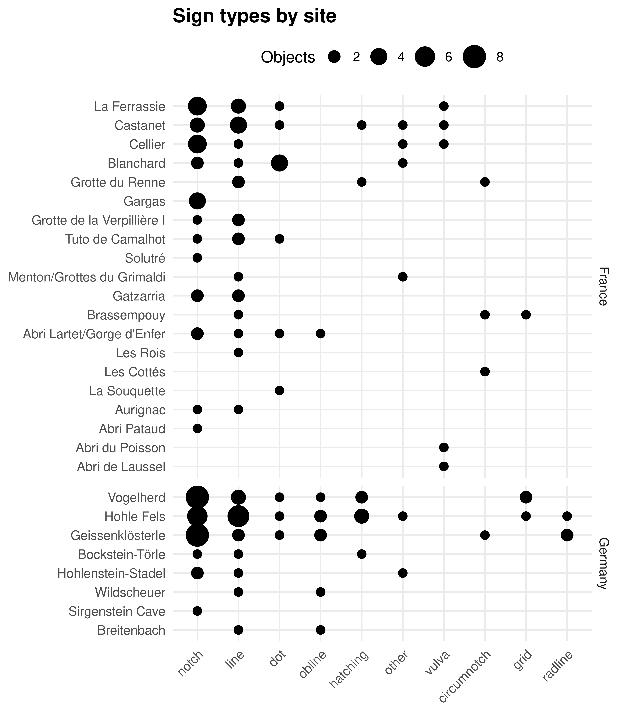

# Marks of the Aurignacian: sign repertoires on mobile objects from
Germany and France

2026-11-24

``` r
library(tidyverse)
```

    ── Attaching core tidyverse packages ──────────────────────── tidyverse 2.0.0 ──
    ✔ dplyr     1.2.1     ✔ readr     2.2.0
    ✔ forcats   1.0.1     ✔ stringr   1.6.0
    ✔ ggplot2   4.0.4     ✔ tibble    3.3.1
    ✔ lubridate 1.9.5     ✔ tidyr     1.3.2
    ✔ purrr     1.2.2     
    ── Conflicts ────────────────────────────────────────── tidyverse_conflicts() ──
    ✖ dplyr::filter() masks stats::filter()
    ✖ dplyr::lag()    masks stats::lag()
    ℹ Use the conflicted package (<http://conflicted.r-lib.org/>) to force all conflicts to become errors

``` r
signbase <- read_csv("signbase.csv", show_col_types = FALSE)
theme_set(theme_minimal(base_size = 13) +
            theme(plot.title = element_text(face = "bold"), legend.position = "top"))
```

## Introduction

The Aurignacian, about 43,000–33,000 years ago, is the first Upper
Palaeolithic technocomplex to spread across most of Europe. Its
best-known objects come from Hohle Fels and Geissenklösterle, two caves
in the Lone Valley of the Swabian Jura, where ivory figurines and flutes
were found in well-dated layers (Higham et al., 2012). The Hohle Fels
female figurine, carved from mammoth ivory, is at least 35,000 years old
(Conard, 2009).

Most Aurignacian marks, however, are not figurative. They are notches,
lines, dots and crosses on tools, ornaments and stone blocks. Repeated
sequences of such marks have been read as possible notational or
information-storage devices (McPherron et al., 2022). If they were
shared conventions, their repertoires might differ between regions, as
personal ornaments do (Vanhaeren & d’Errico, 2006). Using SignBase
(Dutkiewicz et al., 2020), I ask whether sign repertoires differ between
Germany and France.

## Methods

SignBase v1.0 (Bentz et al., 2020) records 531 Aurignacian mobile
objects from 65 sites in 13 countries, with 31 binary columns for the
presence of each sign type. Germany (n = 264) and France (n = 148)
provide most records, so I restricted the analysis to these two
countries and removed duplicate records. I calculated the proportion of
objects carrying each sign type in each country and counted the objects
from each site.

``` r
# Focus on the two best-documented countries and remove duplicate records
signs_focus <- signbase |>
  filter(country %in% c("Germany", "France"))  |>
  distinct(site_name, object_type, .keep_all = TRUE)

sign_freq <- signs_focus |>
  pivot_longer(line:other, names_to = "sign", values_to = "present") |>
  summarise(prop = mean(present, na.rm = TRUE),
            n_present = sum(present, na.rm = TRUE), .by = c(country, sign))

top10 <- sign_freq |>
  summarise(n = sum(n_present), .by = sign) |>
  slice_max(n, n = 10, with_ties = FALSE) |>
  pull(sign)

site_counts <- signs_focus |>
  count(country, site_name) |>
  mutate(share = n / sum(n), .by = country)

top_site <- site_counts |>
  slice_max(n, n = 1, by = country, with_ties = FALSE)
top_de <- filter(top_site, country == "Germany")
top_fr <- filter(top_site, country == "France")
```

## Results

The analysed sample contains 108 objects (46 German, 62 French). The
most frequent sign type is *notch* in Germany and *notch* in France. The
German objects come from 9 sites and the French objects from 21.
<a href="#fig-sites" class="quarto-xref">Figure 1</a> shows how the
common sign types are spread across these sites.

``` r
site_signs <- signs_focus |>
  pivot_longer(all_of(top10), names_to = "sign", values_to = "present") |>
  summarise(n = sum(present, na.rm = TRUE), .by = c(country, site_name, sign)) |>
  filter(n > 0) |>
  left_join(select(site_counts, site_name, n_site = n), by = "site_name")

site_signs |>
  ggplot(aes(factor(sign, levels = top10), fct_reorder(site_name, n_site),
             size = n)) +
  geom_point() +
  facet_grid(rows = vars(country), scales = "free_y", space = "free_y") +
  scale_size_area(max_size = 8) +
  labs(title = "Sign types by site", x = NULL, y = NULL, size = "Objects") +
  theme(axis.text.x = element_text(angle = 45, hjust = 1))
```

<div id="fig-sites">




Figure 1: Number of objects at each site carrying each of the ten most
common sign types. Sites are ordered by their total number of analysed
objects; sites with none of these sign types are not shown.

</div>

## Discussion

These patterns should be read cautiously. Vogelherd alone supplies 30%
of the German objects, and Castanet supplies 13% of the French ones, so
a national difference may reflect the excavation and preservation
history of a few sites. Objects from the same layer are not independent,
so sites rather than objects are the better unit of comparison.

## Conclusion

In this sample, Germany and France share their common sign types and
differ only in rare ones. Notches and lines are the two most frequent
signs in both countries. Notches appear on 57% of German objects and 45%
of French objects, and lines on 35% and 35%. The contrasts are in signs
found on fewer than ten objects: oblique lines occur on 15% of German
objects but 2% of French ones, and vulva signs appear only in France, on
8% of French objects. Three sites (Vogelherd, Hohle Fels, and
Geissenklösterle) supply 80% of the German objects, so these few
rare-sign contrasts do not yet show separate regional traditions.

## References

Bentz, C., Dutkiewicz, E., Russo, G., & Lee, S. (2020). *SignBase main
data file* \[Data set\]. figshare.
https://doi.org/10.6084/m9.figshare.12000018.v1

Conard, N. J. (2009). A female figurine from the basal Aurignacian of
Hohle Fels Cave in southwestern Germany. *Science*, 459(7244), 248–252.

Dutkiewicz, E., Russo, G., Lee, S., & Bentz, C. (2020). SignBase, a
collection of geometric signs on mobile objects in the Paleolithic.
*Scientific Data*, 7, 364. https://doi.org/10.1038/s41597-020-00704-x

Higham, T., Basell, L., Jacobi, R., Wood, R., Bronk Ramsey, C., &
Conard, N. J. (2012). Testing models for the beginnings of the
Aurignacian and the advent of figurative art and music: The radiocarbon
chronology of Geißenklösterle. *Journal of Human Evolution*, 62(6),
664–676.

McPherron, S. P., Archer, W., Otárola-Castillo, E. R., Torquato, M. G.,
& Keevil, T. L. (2022). Machine learning, bootstrapping, null models,
and why we are still not 100% sure which bone surface modifications were
made by crocodiles. *Journal of Human Evolution*, 164, 103071.

Vanhaeren, M., & d’Errico, F. (2006). Aurignacian ethno-linguistic
geography of Europe revealed by personal ornaments. *Journal of
Archaeological Science*, 33(8), 1105–1128.

## Reflections

Catches and misses: what did the skills catch that you would have
missed, and what did they miss or get wrong?

One of the claims that I would have missed is the one under Methods that
lists 13 countries and cites Bentz et al., though, per the AI, there are
only about 10 listed in the paper. However, going through the paper,
there is a figure that lists 12 countries, while most other areas don’t
list a specific number of countries, but rather reference several by
name. I also would not have caught the code error that doesn’t separate
sites by country, so if the same name appears in different countries,
they are grouped together as one. I don’t think they got anything wrong,
but it does flag one of the citations as possibly having the wrong
author order, although just looking at the online publications, they
seem to be in the correct order.

Trust: which outputs would you trust without checking, and why?

The more basic corrections, like keeping the spelling of Geißenklösterle
consistent, or other minor corrections because they are straightforward
and don’t require a check on the data or source.

Time: how long did checking the agent’s work take compared with
producing it?

The agents took about two days to fully work through everything, while
my check, which was a bit more of an overview of the suggested
corrections, only took 1-2 hours. Even if I were to take a deeper look
at all of the suggestions, it would likely take less than a day to go
through everything in more detail.

Your project: how will you use (or not use) these skills on your final
project? Imagine that the final project requires a statement about how
you used AI, what would you write in your AI-use statement?

I think both skills will be helpful for my final project, especially the
one that looks at code. I am not very strong at writing code and, based
on this assignment, it can be easy to accidentally group rows or columns
in your data together that you don’t mean to with the wrong or
incomplete code. The code that looks at claims and citations can be
helpful with cleaning up the final paper, since editing a paper could
leave unsupported claims or incorrect citations.

My AI use statement: While AI agents were used throughout all parts of
this project, from conception to final output, there was human input,
oversight, and validation at every step. The work of summarizing,
analyzing, and interpreting results was all human.
